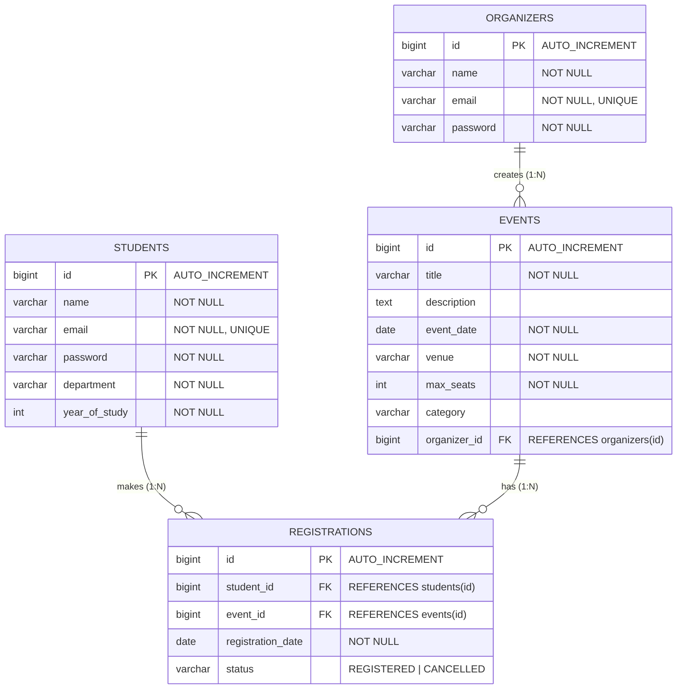

# EventEase — College Event Registration System

> A robust, clean, and full-featured College Event Registration and Management Web Application built with **Java 21**, **Spring Boot 3.3.4**, **Spring Data JPA**, **Thymeleaf**, **Pure CSS3**, and **MySQL**.

---

## Table of Contents

1. [Project Title & Description](#1-project-title--description)
2. [Problem Statement & Objectives](#2-problem-statement--objectives)
3. [Core Features](#3-core-features)
4. [Technology Stack](#4-technology-stack)
5. [Database Design & ER Diagram](#5-database-design--er-diagram)
6. [Entity Relationships](#6-entity-relationships)
7. [Mandatory Business Rules](#7-mandatory-business-rules)
8. [Project Structure Tree](#8-project-structure-tree)
9. [MySQL Database Setup](#9-mysql-database-setup)
10. [Application Properties Configuration](#10-applicationproperties-configuration)
11. [How to Run the Project](#11-how-to-run-the-project)
12. [Thymeleaf Frontend Pages Breakdown](#12-thymeleaf-frontend-pages-breakdown)
13. [Complete REST API Endpoints Documentation](#13-complete-rest-api-endpoints-documentation)
14. [Step-by-Step Testing & Demonstration Scenarios](#14-step-by-step-testing--demonstration-scenarios)
15. [Sample Data Details](#15-sample-data-details)
16. [Git Version Control Commands](#16-git-version-control-commands)
17. [Viva Explanation Highlights](#17-viva-explanation-highlights)

---

## 1. Project Title & Description

**EventEase** is an enterprise-grade, beginner-friendly College Event Management and Seat Reservation web portal. In modern collegiate environments, student clubs, academic departments, and sports committees organize dozens of hackathons, technical seminars, cultural festivals, and athletic tournaments each semester. 

EventEase streamlines the entire lifecycle of campus events:
- **Organizers** can create, update, monitor, and manage campus events with custom seat capacities.
- **Students** can discover upcoming events, check live real-time seat availability, register with a single click, view their booking history, and cancel registrations if needed.
- **Real-Time Capacity Management** ensures that when an event reaches maximum capacity, further registrations are blocked. If a student cancels, the seat is immediately freed up for another student.

---

## 2. Problem Statement & Objectives

### The Problem
Traditional college event management suffers from severe operational bottlenecks:
- **Manual Paper & Google Forms**: Scattered registrations lead to lost student data and overbooking beyond hall capacities.
- **No Real-Time Seat Allocation**: Students arrive at workshops only to find venues full because forms did not stop accepting submissions when seats filled up.
- **Duplicate & Fake Bookings**: Without system-level validation, students register multiple times under the same event.
- **Zero Cancellation Tracking**: When registered students cannot attend, there is no mechanism to reclaim their seats for waitlisted peers.
- **Lack of Centralization**: Organizers and department heads have no unified dashboard to view participant rosters.

### Project Objectives
1. **Automated Seat Accounting**: Guarantee atomic seat counting where `Available Seats = maxSeats - REGISTERED seats`.
2. **Strict Business Invariant Enforcement**: Prohibit duplicate registrations, prevent overbooking past `maxSeats`, and block post-event cancellations.
3. **Dual Architecture (MVC + REST)**: Deliver server-side rendered Thymeleaf web pages for end-users, alongside clean RESTful API JSON endpoints for third-party mobile or web integrations.
4. **Zero-Configuration Onboarding**: Provide an automated `DataLoader` that populates 10 organizers, 50 students, and 20 categorized events on initial startup.
5. **Simplicity & Maintainability**: Clean separation of concerns across Model, View, Controller, Service, and Repository layers using standard Spring conventions.

---

## 3. Core Features

- 🎪 **Event Discovery & Filtering**: Search events by title keyword or filter dynamically by category (`Technical`, `Workshop`, `Cultural`, `Sports`, `Seminar`).
- 🎟️ **One-Click Student Registration**: Intuitive registration modal/page with student ID verification and instant feedback.
- ⚡ **Live Real-Time Seat Availability**: Badges automatically change from green (*"N Seats Left"*) to red (*"Full / Registration Closed"*) based on active bookings.
- ❌ **Smart Registration Cancellation**: Students can cancel their own bookings prior to the event date. Cancelled bookings free up seats instantly without deleting historical audit logs.
- 🏢 **Organizer Event Management**: Department heads and club leads can create events, edit logistics, update venues/dates, and inspect participant lists.
- 👥 **Participant Roster View**: Event organizers can view all students registered for an event with timestamps and status.
- 🛡️ **Robust Validation & Error Handling**: Comprehensive form validation using Jakarta Validation (`@NotBlank`, `@Email`, `@Positive`, `@NotNull`) and custom exception handlers.
- 📊 **Dynamic Dashboard Metrics**: Homepage displaying live campus stats including total available events and registered students.

---

## 4. Technology Stack

| Layer / Component | Technology | Version | Description |
| :--- | :--- | :--- | :--- |
| **Language** | Java (JDK) | **21 (LTS)** | Modern Java with records, pattern matching, and enhanced switch |
| **Framework** | Spring Boot | **3.3.4** | Standalone production-grade Spring framework |
| **Web MVC** | Spring MVC | 3.3.4 | Dispatches web requests and maps controller endpoints |
| **Template Engine** | Thymeleaf | 3.3.4 | Modern server-side Java template engine for HTML5 |
| **ORM / Persistence** | Hibernate / JPA | 3.3.4 | Object-Relational Mapping with `jakarta.persistence` |
| **Data Access** | Spring Data JPA | 3.3.4 | Repository abstraction for boilerplate-free CRUD & query methods |
| **Validation** | Jakarta Bean Validation | 3.0+ | `@NotBlank`, `@Email`, `@Positive`, `@NotNull` annotations |
| **Database** | MySQL Server | **8.0+** | Relational database management system |
| **Database Driver** | MySQL Connector/J | Runtime | JDBC driver for MySQL connectivity |
| **Build & Dependency** | Apache Maven | **3.9+** | Build automation and dependency management tool |
| **Styling** | Custom CSS3 | Pure CSS | Responsive, CSS variables, grid, flexbox, zero external CSS dependencies |

---

## 5. Database Design & ER Diagram

The database schema `eventease_db` comprises 4 relational tables: `organizers`, `students`, `events`, and `registrations`.



---

## 6. Entity Relationships

1. **Organizer to Event (`1 : N`)**:
   - One `Organizer` (club/department) can create and manage multiple `Events`.
   - Each `Event` is owned by exactly one `Organizer`.
   - Mapped in `Event.java` using `@ManyToOne` with `@JoinColumn(name = "organizer_id")`.

2. **Student to Registration (`1 : N`)**:
   - One `Student` can make multiple `Registrations` across different campus events.
   - Each `Registration` belongs to exactly one `Student`.
   - Mapped in `Registration.java` using `@ManyToOne` with `@JoinColumn(name = "student_id")`.

3. **Event to Registration (`1 : N`)**:
   - One `Event` receives multiple `Registrations` from interested students.
   - Each `Registration` is tied to exactly one `Event`.
   - Mapped in `Registration.java` using `@ManyToOne` with `@JoinColumn(name = "event_id")`.

4. **Student to Event (`M : N` through `Registration`)**:
   - The `Registration` entity serves as the associative join entity with additional attributes (`registrationDate`, `status`).

---

## 7. Mandatory Business Rules

EventEase strictly enforces 6 non-negotiable business rules in `RegistrationService.java` and `EventService.java`:

| Rule # | Business Rule | Implementation & Enforcement Logic |
| :---: | :--- | :--- |
| **BR-1** | **Maximum Seat Capacity** | Before completing a registration, the system queries `findByEventIdAndStatus(eventId, "REGISTERED")`. If `count >= event.getMaxSeats()`, registration is rejected with `BusinessException("Registration failed: No seats are available for this event.")`. |
| **BR-2** | **Duplicate Prevention** | A student cannot hold multiple active registrations for the same event. Checked via `findByStudentIdAndEventIdAndStatus(studentId, eventId, "REGISTERED")`. If found, rejected with `BusinessException("You are already registered for this event.")`. |
| **BR-3** | **Soft Cancellation Frees Seat** | When a registration is cancelled, the database record is **never deleted**. Its status is changed from `REGISTERED` to `CANCELLED`. Because seat counting only counts `REGISTERED` rows, a cancelled seat is instantly available to others. |
| **BR-4** | **Re-Registration Allowed** | If a student previously cancelled their registration for an event, they are permitted to register again if seats remain open. |
| **BR-5** | **Own Cancellation Only** | A student can only cancel their own registration. The system verifies `registration.getStudent().getId().equals(studentId)`; otherwise, throws `BusinessException("You can only cancel your own registration.")`. |
| **BR-6** | **Cancellation Before Event Date** | A registration cannot be cancelled once the event date has arrived or passed (`LocalDate.now().isAfter(eventDate)`). This prevents last-minute slot wastage. |

### Available Seats Mathematical Formula
$$\text{Available Seats} = \text{maxSeats} - \text{COUNT}(\text{Registrations where } \text{status} = \text{'REGISTERED'})$$

---

## 8. Project Structure Tree

```
EventEase College/
├── pom.xml
├── README.md
├── PROJECT_EXPLANATION.md
└── src/
    └── main/
        ├── java/
        │   └── com/
        │       └── eventease/
        │           ├── EventEaseApplication.java         # Spring Boot Entry Point (main)
        │           ├── DataLoader.java                   # CommandLineRunner: 10 Org, 50 Stu, 20 Events
        │           ├── entity/                           # JPA Data Entities
        │           │   ├── Organizer.java
        │           │   ├── Student.java
        │           │   ├── Event.java
        │           │   └── Registration.java
        │           ├── repository/                       # Spring Data JPA Repositories
        │           │   ├── OrganizerRepository.java
        │           │   ├── StudentRepository.java
        │           │   ├── EventRepository.java
        │           │   └── RegistrationRepository.java
        │           ├── service/                          # Business Logic Layer
        │           │   ├── OrganizerService.java
        │           │   ├── StudentService.java
        │           │   ├── EventService.java
        │           │   └── RegistrationService.java
        │           ├── controller/                       # Controllers (Thymeleaf & REST)
        │           │   ├── HomeController.java           # "/"
        │           │   ├── EventController.java          # "/events", "/events/*", "/api/events"
        │           │   ├── RegistrationController.java   # "/register/*", "/student/*", "/api/registrations"
        │           │   ├── StudentController.java        # "/api/students"
        │           │   └── OrganizerController.java      # "/api/organizers"
        │           └── exception/                        # Custom Exceptions & Global Handlers
        │               ├── ResourceNotFoundException.java
        │               ├── BusinessException.java
        │               └── GlobalExceptionHandler.java
        └── resources/
            ├── application.properties                    # MySQL & Spring Boot config
            ├── static/
            │   └── css/
            │       └── style.css                         # Clean, responsive CSS stylesheet
            └── templates/                                # Thymeleaf HTML5 Templates
                ├── index.html                            # Landing page & stats
                ├── events.html                           # Event catalog with search & filter
                ├── event-details.html                    # Single event view
                ├── register.html                         # Event registration page
                ├── my-registrations.html                 # Student bookings & cancellation
                ├── create-event.html                     # Organizer event creation form
                ├── edit-event.html                       # Organizer event edit form
                ├── organizer-events.html                 # Organizer-specific events dashboard
                └── participants.html                     # Event participant roster
```

---

## 9. MySQL Database Setup

1. Open your MySQL client (MySQL Workbench, MySQL Command Line Client, or phpMyAdmin).
2. Log in as `root` (or your configured administrative user).
3. Execute the following SQL command:

```sql
-- Create database schema for EventEase
CREATE DATABASE IF NOT EXISTS eventease_db CHARACTER SET utf8mb4 COLLATE utf8mb4_unicode_ci;

-- Verify creation
SHOW DATABASES;
```

> [!NOTE]
> You do **not** need to write `CREATE TABLE` statements manually. Spring Data JPA with `spring.jpa.hibernate.ddl-auto=update` will automatically create all tables (`organizers`, `students`, `events`, `registrations`) and foreign keys on first run.

---

## 10. `application.properties` Configuration

The configuration file is located at `src/main/resources/application.properties`:

```properties
# ===================================================================
# EventEase Application Configuration
# ===================================================================
spring.application.name=EventEase

# Server Port
server.port=8080

# MySQL Database DataSource Settings
spring.datasource.url=jdbc:mysql://localhost:3306/eventease_db?useSSL=false&serverTimezone=UTC&allowPublicKeyRetrieval=true
spring.datasource.username=root
spring.datasource.password=YOUR_MYSQL_PASSWORD
spring.datasource.driver-class-name=com.mysql.cj.jdbc.Driver

# JPA / Hibernate Configuration
spring.jpa.hibernate.ddl-auto=update
spring.jpa.show-sql=true
spring.jpa.properties.hibernate.format_sql=true
spring.jpa.properties.hibernate.highlight_sql=true
spring.jpa.database-platform=org.hibernate.dialect.MySQLDialect

# Thymeleaf Template Engine Settings
spring.thymeleaf.cache=false
spring.thymeleaf.prefix=classpath:/templates/
spring.thymeleaf.suffix=.html
spring.thymeleaf.mode=HTML
spring.thymeleaf.encoding=UTF-8
```

> [!IMPORTANT]
> Replace `YOUR_MYSQL_PASSWORD` with your local MySQL password.

---

## 11. How to Run the Project

### Prerequisites
- **JDK 21** installed (`java -version`)
- **Maven 3.9+** installed (`mvn -version`)
- **MySQL Server 8.0+** running on port 3306

### Option A: Using Maven Command Line (Terminal / PowerShell)

```bash
# 1. Navigate to the project root directory
cd "C:\Users\smart com\Downloads\EventEase College"

# 2. Build the project and download dependencies
mvn clean install

# 3. Run the Spring Boot application
mvn spring-boot:run
```

### Option B: Using VS Code
1. Open VS Code and open folder: `C:\Users\smart com\Downloads\EventEase College`.
2. Ensure the **Extension Pack for Java** and **Spring Boot Extension Pack** are installed.
3. Open `src/main/java/com/eventease/EventEaseApplication.java`.
4. Click **Run** or **Debug** above the `main` method.

### Option C: Using IntelliJ IDEA / Eclipse
1. Choose **Open / Import Project** -> select the root `pom.xml`.
2. Wait for Maven sync to finish.
3. Right-click `EventEaseApplication.java` -> **Run 'EventEaseApplication'**.

### Accessing the Web Application
Open your browser and navigate to:
- **Web Portal**: [http://localhost:8080](http://localhost:8080)
- **Explore Events**: [http://localhost:8080/events](http://localhost:8080/events)
- **My Registrations**: [http://localhost:8080/my-registrations](http://localhost:8080/my-registrations)

---

## 12. Thymeleaf Frontend Pages Breakdown

| Page File | URL / Route | HTTP Method | Description |
| :--- | :--- | :---: | :--- |
| `index.html` | `/` | `GET` | **Home Landing Page**: Welcome hero banner, campus stats (total events, total students), quick action cards. |
| `events.html` | `/events` | `GET` | **Event Catalog**: Grid/table of upcoming events with real-time seat availability badges, search bar, and category filter chips. |
| `event-details.html` | `/events/{id}` | `GET` | **Event Details View**: Full overview of date, venue, category, organizer details, seat stats, and registration button. |
| `register.html` | `/register/{eventId}` | `GET` / `POST` | **Registration Page**: Student ID lookup/entry form, capacity alerts, and registration submission with success/error alerts. |
| `my-registrations.html` | `/my-registrations`<br>`/student/{id}/registrations` | `GET` / `POST` | **Student Portal**: Student lookup, table of all registered/cancelled bookings, and one-click cancellation button. |
| `create-event.html` | `/events/create` | `GET` / `POST` | **Create Event Form**: Form for organizers to add title, description, date, venue, capacity, category, and select organizer. |
| `edit-event.html` | `/events/edit/{id}` | `GET` / `POST` | **Edit Event Form**: Form to update existing event details and capacities. |
| `organizer-events.html` | `/organizer/{id}/events` | `GET` | **Organizer Dashboard**: List of all events hosted by a particular department/club with management actions. |
| `participants.html` | `/events/{id}/participants`<br>`/events/{id}/registrations` | `GET` | **Participants Roster**: Table showing all students who registered for a given event, including status and dates. |

---

## 13. Complete REST API Endpoints Documentation

EventEase provides a comprehensive RESTful API for headless integration:

### 1. Events API (`/api/events`)

| Method | Endpoint | Request Body / Params | Response | Description |
| :---: | :--- | :--- | :---: | :--- |
| `GET` | `/api/events` | None | `200 OK` (JSON List) | Retrieve all events |
| `GET` | `/api/events/{id}` | None | `200 OK` (JSON Object) | Retrieve event by ID |
| `POST` | `/api/events?organizerId={id}` | JSON Event Body | `200 OK` (Created Event) | Create a new event |
| `PUT` | `/api/events/{id}` | JSON Event Body | `200 OK` (Updated Event) | Update an existing event |
| `DELETE` | `/api/events/{id}` | None | `200 OK` (String Message) | Delete an event |

### 2. Registrations API (`/api/registrations`)

| Method | Endpoint | Request Body / Params | Response | Description |
| :---: | :--- | :--- | :---: | :--- |
| `POST` | `/api/registrations` | `studentId={id}&eventId={id}` | `200 OK` (JSON Registration) | Register a student for an event |
| `GET` | `/api/registrations/{id}` | None | `200 OK` (JSON Registration) | Get registration by ID |
| `GET` | `/api/registrations/student/{studentId}` | None | `200 OK` (JSON List) | Get all registrations for a student |
| `GET` | `/api/registrations/event/{eventId}` | None | `200 OK` (JSON List) | Get all registrations for an event |
| `PUT` | `/api/registrations/{id}/cancel` | `studentId={id}` | `200 OK` (JSON Message) | Cancel a registration |

### 3. Students API (`/api/students`)

| Method | Endpoint | Request Body / Params | Response | Description |
| :---: | :--- | :--- | :---: | :--- |
| `GET` | `/api/students` | None | `200 OK` (JSON List) | Retrieve all students |
| `GET` | `/api/students/{id}` | None | `200 OK` (JSON Object) | Retrieve student by ID |
| `POST` | `/api/students` | JSON Student Body | `200 OK` (Created Student) | Create a new student |
| `PUT` | `/api/students/{id}` | JSON Student Body | `200 OK` (Updated Student) | Update student profile |
| `DELETE` | `/api/students/{id}` | None | `200 OK` (String Message) | Delete a student |

### 4. Organizers API (`/api/organizers`)

| Method | Endpoint | Request Body / Params | Response | Description |
| :---: | :--- | :--- | :---: | :--- |
| `GET` | `/api/organizers` | None | `200 OK` (JSON List) | Retrieve all organizers |
| `GET` | `/api/organizers/{id}` | None | `200 OK` (JSON Object) | Retrieve organizer by ID |
| `POST` | `/api/organizers` | JSON Organizer Body | `200 OK` (Created Organizer) | Create a new organizer |
| `PUT` | `/api/organizers/{id}` | JSON Organizer Body | `200 OK` (Updated Organizer) | Update organizer details |
| `DELETE` | `/api/organizers/{id}` | None | `200 OK` (String Message) | Delete an organizer |

---

## 14. Step-by-Step Testing & Demonstration Scenarios

To demonstrate the application in viva examinations or laboratory assessments, follow this test workflow featuring the **2-Seat Java Workshop**:

```
[Initial State: Java Workshop (maxSeats=2, Available=2)]
     │
     ▼
[Step 1: Student 1 (Arun) registers]  ──> Success (Available = 1)
     │
     ▼
[Step 2: Student 2 (Priya) registers] ──> Success (Available = 0, Badge = FULL)
     │
     ▼
[Step 3: Student 3 (Rahul) registers] ──> REJECTED ("No seats available")
     │
     ▼
[Step 4: Student 1 (Arun) tries again]──> REJECTED ("Already registered")
     │
     ▼
[Step 5: Student 1 (Arun) cancels]    ──> Success (Status=CANCELLED, Available = 1)
     │
     ▼
[Step 6: Student 3 (Rahul) registers] ──> Success! (Seat claimed, Available = 0)
```

### Walkthrough Execution Details:

1. **Verify Initial State**:
   - Go to `/events`. Find **"Java Workshop"** (ID: 1).
   - Capacity: `2`, Registered: `0`, Available Seats: `2`.

2. **First Student Registration (Student ID = 1 - Arun Kumar)**:
   - Click **Register** on Java Workshop (`/register/1`).
   - Enter Student ID `1` and click **Confirm Registration**.
   - Result: Success message displayed. Available seats drop to `1`.

3. **Second Student Registration (Student ID = 2 - Priya Sharma)**:
   - Enter Student ID `2` and click **Confirm Registration**.
   - Result: Success message displayed. Available seats drop to `0`. Event badge switches to **"Full (0 Left)"**.

4. **Third Student Registration - Capacity Limit Test (Student ID = 3 - Rahul Verma)**:
   - Try to register with Student ID `3`.
   - Result: Registration is blocked with error: `"Registration failed: No seats are available for this event."`.

5. **Duplicate Registration Test (Student ID = 1 - Arun Kumar)**:
   - Try registering Student ID `1` again for Java Workshop.
   - Result: Registration is blocked with error: `"You are already registered for this event."`.

6. **Cancellation Test (Student ID = 1 - Arun Kumar)**:
   - Go to `/my-registrations`, search for Student ID `1`.
   - Click **Cancel Registration** next to Java Workshop.
   - Result: Status updates to `CANCELLED`. Available seats for Java Workshop increase back to `1`.

7. **Re-claiming Freed Seat (Student ID = 3 - Rahul Verma)**:
   - Return to `/register/1` and register Student ID `3`.
   - Result: Registration succeeds! Available seats return to `0`.

---

## 15. Sample Data Details

The built-in `DataLoader` runs automatically on startup if the database is empty:

### 10 Organizers Preloaded:
1. `Computer Science Dept` (`cs@eventease.com`)
2. `Electronics Dept` (`ece@eventease.com`)
3. `Cultural Club` (`cultural@eventease.com`)
4. `Coding Club` (`coding@eventease.com`)
5. `Sports Committee` (`sports@eventease.com`)
6. `Music Society` (`music@eventease.com`)
7. `Robotics Club` (`robotics@eventease.com`)
8. `IEEE Student Branch` (`ieee@eventease.com`)
9. `ACM Student Chapter` (`acm@eventease.com`)
10. `Literary Club` (`literary@eventease.com`)

### 50 Students Preloaded:
Across Departments: `CSE`, `ECE`, `MECH`, `CIVIL`, `IT` across Academic Years 1 to 4.
- Examples: Arun Kumar (`arun.kumar@eventease.com`, CSE Yr 2), Priya Sharma (`priya.sharma@eventease.com`, ECE Yr 3), Rahul Verma (`rahul.verma@eventease.com`, MECH Yr 4), Anitha Reddy (`anitha.reddy@eventease.com`, CSE Yr 1), Sneha Patel (`sneha.patel@eventease.com`, IT Yr 2), etc.

### 20 Events Preloaded:
| ID | Title | Category | Max Seats | Venue | Organizer |
| :---: | :--- | :--- | :---: | :--- | :--- |
| **1** | **Java Workshop** | Technical | **2** | Lab 3, CS Block | Computer Science Dept |
| **2** | Web Development Bootcamp | Workshop | 40 | Seminar Hall 1 | Coding Club |
| **3** | AI and Machine Learning Seminar | Seminar | 60 | Auditorium A | Computer Science Dept |
| **4** | Annual College Hackathon 2026 | Technical | 50 | Central Computing Lab | ACM Student Chapter |
| **5** | Robotics and IoT Expo | Technical | 45 | Mech Workshop Block | Robotics Club |
| **6** | VLSI Circuit Design Workshop | Workshop | 30 | ECE Lab 2 | Electronics Dept |
| **7** | Cybersecurity & Ethical Hacking | Seminar | 50 | CS Conference Room | IEEE Student Branch |
| **8** | Cloud Computing with AWS & Docker | Workshop | 35 | IT Lab 1 | Coding Club |
| **9** | Inter-College Cricket Tournament | Sports | 100 | Main Sports Ground | Sports Committee |
| **10** | Badminton Championship 2026 | Sports | 32 | Indoor Sports Complex | Sports Committee |
| **11** | Annual Cultural Fest - Tarang | Cultural | 200 | Open Air Theatre | Cultural Club |
| **12** | Battle of the Bands - Rock Night | Cultural | 150 | Amphitheatre | Music Society |
| **13** | Classical Music & Raga Evening | Cultural | 80 | Mini Auditorium | Music Society |
| **14** | Debate & Elocution Competition | Seminar | 40 | Library Seminar Hall | Literary Club |
| **15** | Creative Writing Workshop | Workshop | 25 | Literary Club Room | Literary Club |
| **16** | Embedded Systems with Raspberry Pi | Workshop | 30 | Embedded Systems Lab | Electronics Dept |
| **17** | IEEE International Tech Symposium | Seminar | 75 | Main Auditorium | IEEE Student Branch |
| **18** | ACM Competitive Programming | Technical | 60 | Computer Center 2 | ACM Student Chapter |
| **19** | Table Tennis & Chess Tournament | Sports | 40 | Recreation Center | Sports Committee |
| **20** | Autonomous Drone Building | Seminar | 35 | Robotics Innovation Lab | Robotics Club |

---

## 16. Git Version Control Commands

Essential Git commands to initialize, commit, and manage the project repository:

```bash
# Initialize git repository
git init

# Check working tree status
git status

# Stage all files
git add .

# Create initial commit
git commit -m "feat: complete EventEase college event registration system"

# Add remote GitHub repository (replace with your repo URL)
git remote add origin https://github.com/your-username/EventEase-College.git

# Rename branch to main
git branch -M main

# Push code to remote repository
git push -u origin main
```

---

## 17. Viva Explanation Highlights

When presenting EventEase to external examiners, emphasize these core architectural strengths:

1. **Layered Architecture**: Strict separation between Controller (HTTP routing/presentation), Service (business rules & transactions), Repository (data queries), and Entity (schema definitions).
2. **Deterministic Seat Accounting**: We do not store a mutable `availableSeats` column in the database. Computing available seats on-the-fly (`maxSeats - active_registrations`) eliminates race conditions and data synchronization bugs.
3. **Soft Cancellation Paradigm**: When a registration is cancelled, we maintain the row with `status = 'CANCELLED'`. This preserves historical auditing while immediately freeing up capacity.
4. **Spring Data JPA Derived Queries**: Zero SQL queries needed for standard operations; Spring generates SQL dynamically from method signatures like `findByEventIdAndStatus(Long eventId, String status)`.
5. **Robust Validation**: Two tiers of validation — server-side Bean Validation (`@Valid`, `BindingResult`) and Service-layer business invariant validation (`BusinessException`).

---

*EventEase — Simplifying College Event Coordination with Clean Code and Spring Boot.*
